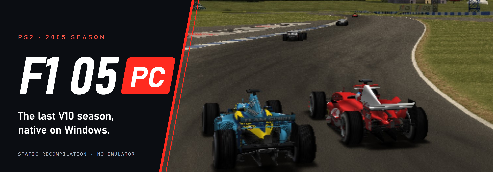
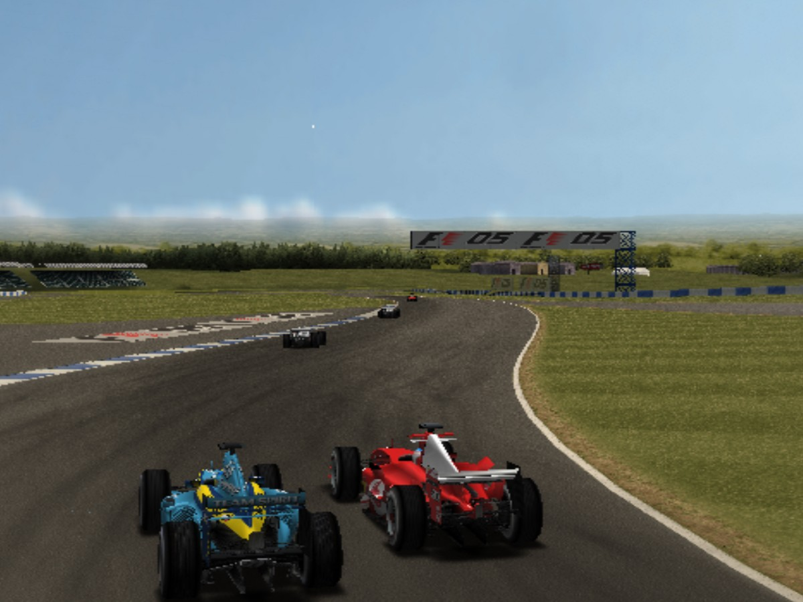
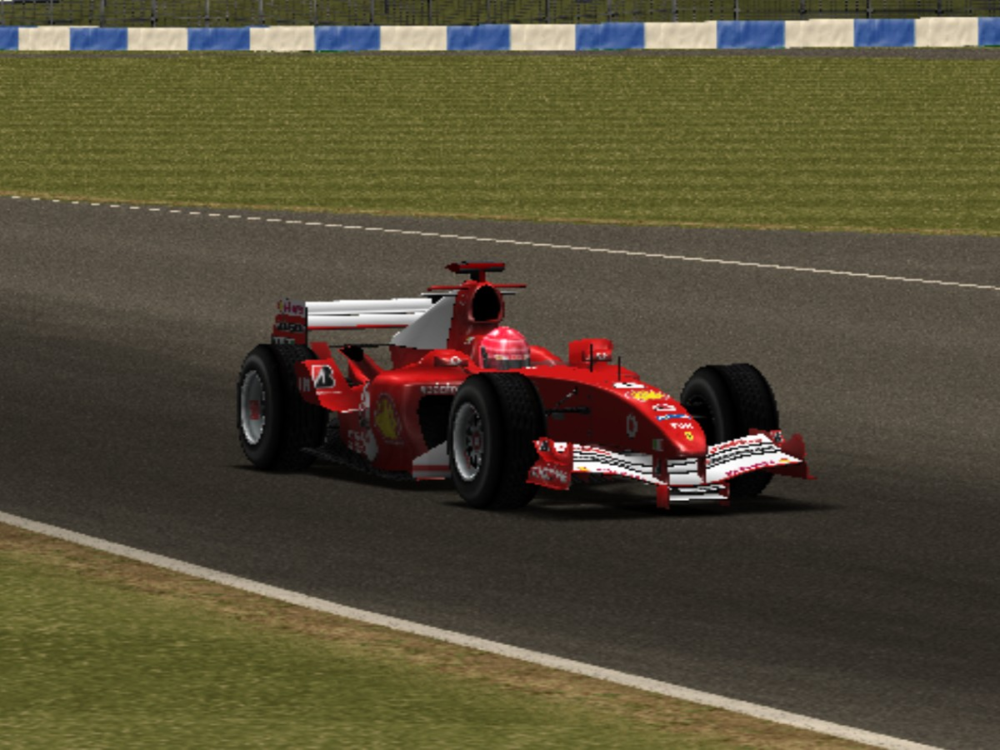
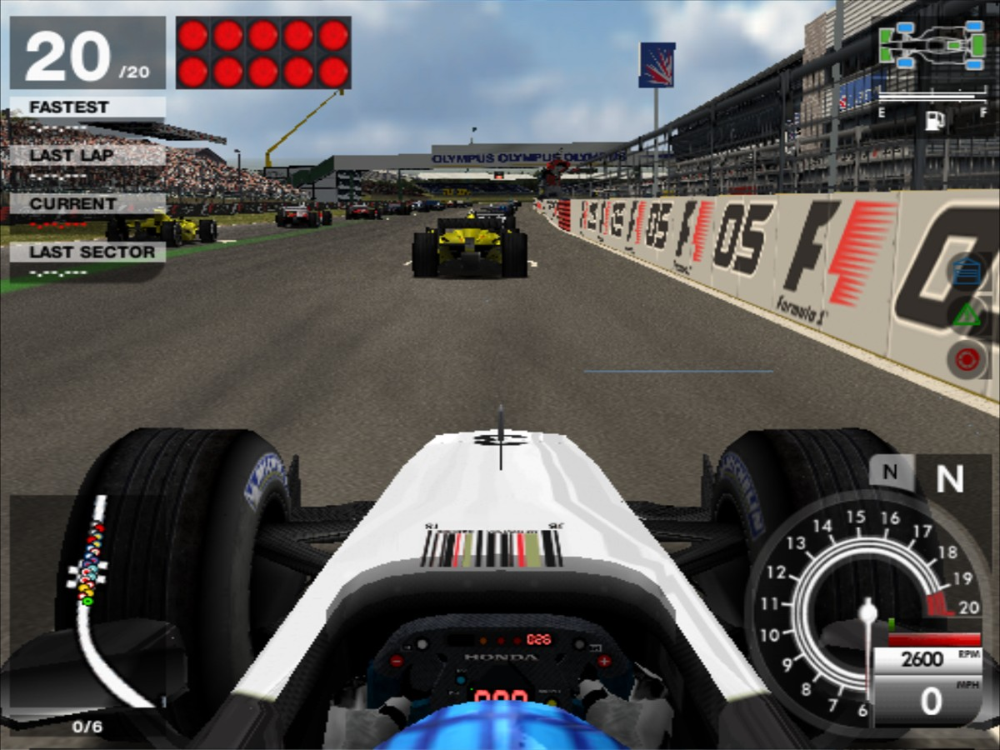
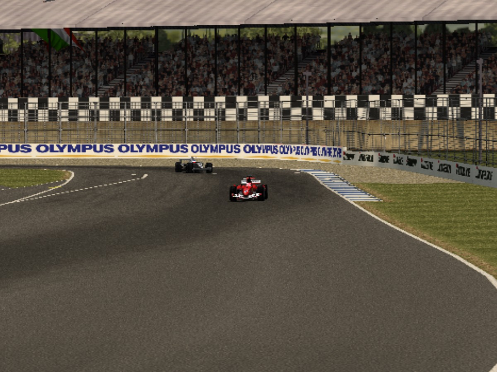
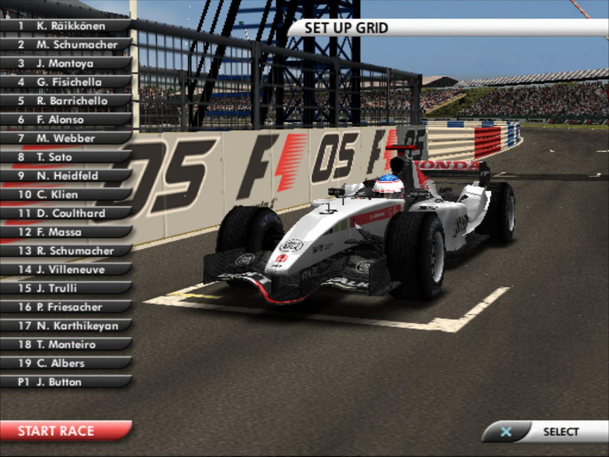
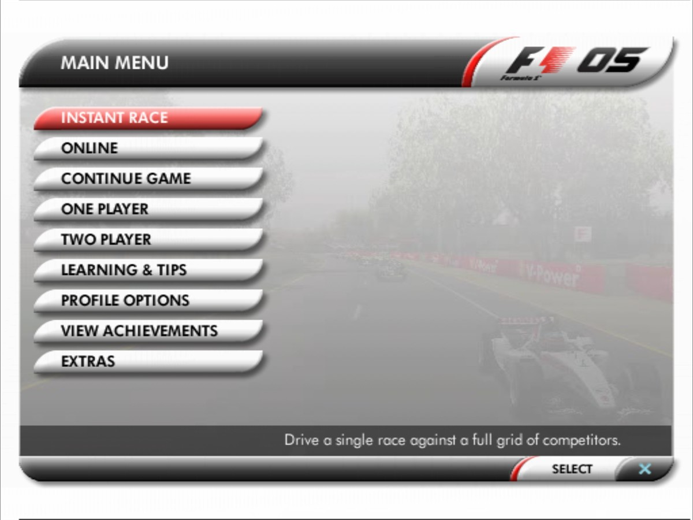

  
  
  

<b>Discord:</b> <a href="https://discord.gg/sSFHTNQsmv">https://discord.gg/sSFHTNQsmv</a>

# F1 05 PC: a native Windows port of Formula One 05 (PS2) by static recompilation

> **Fan project. Not affiliated with, endorsed by or connected to Sony Interactive Entertainment, SCE Studio Liverpool,
> Formula One Group, the FIA or any other rights holder.** No game data is distributed: you need your own copy of the
> game. [Español más abajo](#español).

**F1 05 PC** turns the European PlayStation 2 release of *Formula One 05* (PAL, SCES-53033) into a native Windows
program. This is not an emulator running the disc: the game's MIPS code is translated ahead of time into C++ with
[PS2Recomp](https://github.com/ran-j/PS2Recomp) and compiled into a normal `.exe`, together with a runtime that stands
in for the PS2 hardware (EE, IOP, VU1, SPU2) and draws the GS graphics on your graphics card through
[paraLLEl-GS](https://github.com/Arntzen-Software/parallel-gs) (Vulkan).

The goal is **the original PS2 game, as it is on the console**: the last season of V10 engines, with the full game
and its modes. There are no PC extras inside the game: no new options in its menus, no photo mode, no online play.
What the port adds is only what a PC needs: a window or full screen, rendering on your graphics card, controllers,
keyboard and wheel, and settings in a file (or on the game's page in RecompLauncher).

## Highlights

- **Native PC executable** built by static recompilation, running at **50 fps like the PAL original**.
- **GPU rendering** (paraLLEl-GS over Vulkan, `gs = gpu`, the default) with supersampling and double resolution, and a
  software renderer (`gs = cpu`) as a fallback when Vulkan or `pgs_puente.dll` is missing. Graphics already prepared
  for your card are kept in `cache\`, so there is less stutter the next time.
- **Display**: window, borderless or full screen, window size, aspect ratio (4:3, 16:9, console pixels), scaling
  filter (nearest, bilinear, sharp pixels, AMD FSR 1, CRT), V-Sync and an FPS counter.
- **Controls**: controller, keyboard and steering wheel, with vibration.
- **Memory cards** in `saves\mc0` and `saves\mc1`.
- **Easy setup**: the installer, the game or RecompLauncher checks your own ISO and copies the game data once.
- **Crash reports** with the log attached (see [Reporting a problem](#reporting-a-problem)).

## Screenshots

| | |
|---|---|
|  |  |
| *Wheel to wheel at Silverstone, TV camera* | *Ferrari through a corner, Silverstone* |
|  |  |
| *Onboard, start lights at Silverstone* | *Past the grandstand, Silverstone* |
|  |  |
| *SET UP GRID before the start* | *The game's main menu* |

Screenshots are in-game captures from the game's own data; the trademarks and logos visible in them belong to their
owners.

## Requirements

- Windows 10 or 11, 64-bit.
- A graphics card with Vulkan for the normal (GPU) mode; without it the game draws in software mode (much slower).
- **Your own copy of Formula One 05 for PS2, European PAL version (SCES-53033)**: the Redump "Europe, Australia
  (v1.02)" dump, as an `.iso` file made from your own disc. Other regions and versions are not supported.
- About 3.6 GB of free space for the game data copied from your ISO.
- CPU: the game's speed depends mostly on the speed of one processor core. When the CPU cannot keep up, the game does
  not skip frames: it runs in slow motion.

### Performance tips

- Keep the graphics renderer on **GPU** (`gs = gpu`, the default); the CPU (software) mode is much slower.
- **Supersampling** and **double resolution** only load the graphics card: raise them if it has room, lower them if
  it is very busy. On a slow CPU they do not help.
- Use Windows' *High performance* power plan, and close programs you don't need while you play.

## Installation

1. Download either the **installer** (`.exe`) or the **portable** `.zip` from
   [the latest release](https://github.com/KevinL50-sysadmin/F1-05-PC/releases/latest). What changed in each version
   is in [CHANGELOG.md](CHANGELOG.md).
   - Installer (`F1-05-PC-vX.Y.Z-setup.exe`): creates "F1 05" shortcuts in the Start menu and on the desktop;
     uninstall from Settings > Apps (it asks whether to also delete your saves and options). One installer page lets
     you choose your ISO (already filled in if one is found in your Downloads or on your Desktop) and copies the game
     data during the installation; leave it blank to do it on the first run instead.
   - Portable (`F1-05-PC-vX.Y.Z-portable.zip`): unzip the folder anywhere and open `F1-05.exe`. Everything is saved
     inside that folder, so you can move it or carry it on a USB stick.
   - [RecompLauncher](https://recomplauncher.com/game/f1-05-pc): add F1 05 PC and choose your ISO once. The launcher
     checks it against the known good dump, copies the game data and then starts the game with **Play**. The display
     and graphics settings also appear on the game's page in the launcher.
2. **First run**: if the game data is not there yet, the game asks once for your Formula One 05 ISO. It offers an ISO
   found in your Downloads folder, on your Desktop or next to the `.exe` (or lets you browse for one; the
   `SYSTEM.CNF` of an already extracted disc folder also works), checks that it is the PAL version (SCES-53033),
   copies the game files to `data\` with a progress bar that can be cancelled, and starts. The ISO is only read,
   never changed. After that you just play.
3. Windows may show "Windows protected your PC" (SmartScreen) because the `.exe` is not signed: click **More info**
   and then **Run anyway**.

If the copy is interrupted or cancelled, nothing is left half done and the game asks again. From the command line,
`F1-05.exe --extraer-iso "path\game.iso"` copies the disc without opening the game and `F1-05.exe --comprobar-iso
"path\game.iso"` only checks it (exit codes: 0 done or already there, 1 wrong usage, 2 not Formula One 05 PAL, 3 read,
write or space error, 4 cancelled).

Dump your own disc: the project will never tell you where to download a game image, and does not ship one.

## Controls and settings

- Controller, keyboard or wheel. Buttons and keys are set in `config\controls.ini`, which is explained inside.
- **F11** switches between window and full screen, **F10** changes the aspect ratio (4:3, 16:9, console pixels).
- Close the window (X or Alt+F4) to quit.
- The PC settings (window mode and size, aspect ratio, scaling filter, supersampling, double resolution, V-Sync, FPS
  counter, volume, audio latency and mono, vibration strength, graphics renderer) are in `config\settings.ini`, each
  one explained inside (in Spanish). Delete the file to go back to the defaults. With RecompLauncher you can change
  them on the game's page.

## Where everything is

| What | Portable | Installed |
|---|---|---|
| Game data copied from your ISO | `data\` | `data\` next to the `.exe` (`%LOCALAPPDATA%\F1-05\data` if the game folder cannot be written) |
| Settings (`settings.ini`, `controls.ini`) | `config\` | `Documents\My Games\F1-05\config` |
| Memory cards (your saves) | `saves\mc0`, `saves\mc1` | `Documents\My Games\F1-05\saves` |
| Log | `logs\F1-05.log` | `%LOCALAPPDATA%\F1-05\logs\F1-05.log` |
| Graphics cache (can be deleted) | `cache\` | `%LOCALAPPDATA%\F1-05\cache` |

The portable version is portable because of the `portable.txt` file next to the `.exe`. Copy `saves\` to back up your
saves.

## Known limitations

- With 20 cars at the start and in the pit lane the frame rate can dip briefly below 50; the first race after
  installing also compiles the graphics for your card once (the cache avoids it next time).
- With the software renderer (`gs = cpu`) the pause menu sometimes does not appear: the picture stays on the last
  frame of the race. It does not happen with the GPU renderer, the default.
- A black screen when entering a race has been reported by one player
  ([#2](https://github.com/KevinL50-sysadmin/F1-05-PC/issues/2)); it is being investigated.
- No 60 fps mode (the game runs at the PAL 50 fps). Internal resolution is the PS2's (paraLLEl-GS can double it);
  higher resolutions are upscaled.
- The executable is not code-signed, so SmartScreen warns on first run.

## FAQ

**Why do I need my own ISO?**
The game's code, graphics, sounds and music belong to their rights holders. This project only distributes its own
work: the recompilation tooling and runtime changes. The executable needs the original game data to run, and the only
legal way to get it is from a disc you own.

**Is it legal?**
The project ships no game data, no ISO and no BIOS, and is not a commercial product. Making a personal backup of a
game you own is treated differently from country to country, so check your local law. If you are a rights holder and
have a concern, please open an issue at https://github.com/KevinL50-sysadmin/F1-05-PC/issues.

**Will it get PC options in the game's menus, a photo mode or online play?**
Not for now. F1 05 PC is meant to be the original game as it was on the PS2; the PC settings live in
`config\settings.ini` and on the game's page in RecompLauncher.

**Is this an emulator?**
No. An emulator interprets the PS2 program while it runs; here the game's code was translated to C++ and compiled
for x86-64 ahead of time. Parts of the hardware (graphics synthesiser, sound, I/O processor) are still reproduced by
the runtime, so you can think of it as a native game with a small PS2 "operating layer".

**Which version of the game works?**
Only the European PAL release, SCES-53033 (Redump "Europe, Australia (v1.02)"). Other regions and versions use a
different executable and are not supported.

## Reporting a problem

- **Questions or a quick chat:** the Formula One 2005/2006 PC Discord, the community of F1 05 PC and F1 06 PC:
  https://discord.gg/sSFHTNQsmv (bugs that need a fix are still best as a GitHub issue).
- **With [RecompLauncher](https://recomplauncher.com/game/f1-05-pc):** if the game closes because of a failure (it
  then exits with a code other than 0), the launcher offers to send the report with `F1-05.log` already attached.
- **Otherwise:** open an issue at https://github.com/KevinL50-sysadmin/F1-05-PC/issues (you need a free GitHub
  account), say what you were doing and attach `F1-05.log`.

Where the log is:

- Installed: `%LOCALAPPDATA%\F1-05\logs\F1-05.log` (paste that path into the File Explorer address bar).
- Portable: `logs\F1-05.log` inside the game folder.

Each start replaces the log; the previous session stays in `F1-05.anterior.log`, so attach that one if you opened the
game again after the problem. If the game freezes, wait about 10 seconds before closing it: the log then records
where it got stuck (that wait is `vigilante` in `config\settings.ini`). The log holds the game version, your Windows,
CPU, RAM, graphics card and game settings, plus folder paths that can include your Windows user name; nothing else
from your PC.

## Support the project

If you'd like to support the work, there is a Ko-fi: **https://ko-fi.com/kevinl50**. Donations fund the time spent on
the port and the tools behind it. They never buy builds, features or game content: everything stays free for
everyone.

Bug reports are just as valuable: see [Reporting a problem](#reporting-a-problem).

Follow progress and news on X: **https://x.com/KevinLA50**.

## Legal notice

*Formula One 05* is © its respective owners. "Formula One", "Formula 1", "F1", "PlayStation", "PS2" and related marks
are trademarks of their respective owners and are used here only to describe what the project is compatible with.
This is an independent, non-commercial fan project. It is not affiliated with, endorsed by or sponsored by Sony
Interactive Entertainment, SCE Studio Liverpool, Formula One Group, the FIA or any other rights holder. No game
assets, ISO images or BIOS files are distributed; no official logo is used as project branding.

## Credits and third-party software

- **[PS2Recomp](https://github.com/ran-j/PS2Recomp)**: the PlayStation 2 static recompiler and runtime this port is
  built on (GPL-3.0). This project's changes to it are kept as patches in `parches/`.
- **[paraLLEl-GS](https://github.com/Arntzen-Software/parallel-gs)**: GS rendering on the GPU with Vulkan (LGPL-3.0
  or later), with **[Granite](https://github.com/Themaister/Granite)** (MIT), **volk** (MIT) and **Vulkan-Headers**
  (Apache-2.0 or MIT). Their source and licenses ship in the package's `licenses\` folder.
- **[raylib](https://github.com/raysan5/raylib)** (zlib) and **[Dear ImGui](https://github.com/ocornut/imgui)** (MIT),
  pulled in by PS2Recomp's runtime; other PS2Recomp build dependencies: fmt, ELFIO, toml11, libdwarf, rabbitizer,
  nlohmann/json (each under its own license).
- **AMD FidelityFX Super Resolution 1** (EASU and RCAS, MIT), adapted to GLSL for the FSR scaling filter.
- **FFmpeg** DLLs for the game's videos (LGPL).
- Built on the work done for [F1 06 PC](https://github.com/KevinL50-sysadmin/F1-06-PC).
- Thanks to SCE Studio Liverpool for the original game, and to the PS2 preservation and recompilation communities.

Project license: [GNU GPL-3.0](LICENSE), the same as PS2Recomp, which the runtime derives from. The license covers the
port's own code only; Formula One 05 and its data belong to their owners and are never included.

## Building from source (developers)

Source: https://github.com/KevinL50-sysadmin/F1-05-PC. The repository holds only the project's own work: `src/`
(game-specific overrides), `parches/` (patches over PS2Recomp), `gpu/pgs_puente/` (the paraLLEl-GS bridge DLL),
`config/recomp.toml`, `scripts/` (build, packaging and analysis tools; comments in Spanish) and the root `.cmd` build
scripts. It never contains game data, the game's executable or the C++ code generated from it.

Outline (Windows, from the project root):

1. Clone [PS2Recomp](https://github.com/ran-j/PS2Recomp) into `third_party\PS2Recomp`, check out the base commit
   `2c5fbb9389e11dd95693385969490c9e8e6f57b4` and apply `parches\*.patch` on top of it in numeric order (for example
   `git apply --whitespace=nowarn` for each one, from `0001` up).
2. Put portable MSVC, Windows SDK, CMake and Ninja in `tools\` (`entorno.cmd` sets up a console with them).
3. `compilar-ps2recomp.cmd` builds PS2Recomp in `build\ps2recomp`.
4. Extract your own disc into `juego\` (`scripts\iso_ps2.py`), then `recompilar.cmd` translates `juego\SCES_530.33` to
   C++ and builds the executable (`compilar-runner.cmd` rebuilds it after changes in `src\`).
5. `scripts\obtener-parallel-gs.ps1` fetches paraLLEl-GS at the pinned commit and builds `pgs_puente.dll`.
6. `ejecutar.cmd` runs the development build; `scripts\empaquetar.ps1` makes the portable package and the installer.

---

## Español

> **Proyecto de fans. Sin relación con Sony Interactive Entertainment, SCE Studio Liverpool, Formula One Group, la FIA
> ni ningún otro titular de derechos, ni respaldado por ellos.** No se distribuye nada del juego: necesitas tu propia
> copia.

**F1 05 PC** convierte la edición europea de PlayStation 2 de *Formula One 05* (PAL, SCES-53033) en un programa nativo
de Windows. No es un emulador que lee el disco: el código MIPS del juego se traduce de antemano a C++ con PS2Recomp y
se compila en un `.exe` normal, con un runtime que hace de hardware de la PS2 y dibuja los gráficos en tu tarjeta
gráfica con paraLLEl-GS (Vulkan). El objetivo es **el juego original de PS2, tal como es en la consola**, sin extras
de PC dentro del juego (ni opciones nuevas en sus menús, ni modo foto, ni juego en red). Solo añade lo que necesita un
PC: ventana o pantalla completa, dibujo por GPU, mando, teclado y volante, y opciones en un archivo (o en la ficha de
RecompLauncher).

**Funciones:** 50 fps como el original PAL; dibujo por GPU (paraLLEl-GS, Vulkan) con supersampling y doble
resolución, o por CPU de respaldo; ventana, sin bordes o pantalla completa; aspecto 4:3, 16:9 o píxeles de la consola;
filtros de escalado (más cercano, bilineal, píxeles nítidos, AMD FSR 1, CRT); sincronización vertical y contador de
FPS; mando, teclado y volante, con vibración; memory cards en `saves\`; informes de fallo con el log adjunto.

**Requisitos:** Windows 10/11 de 64 bits, tarjeta gráfica con Vulkan (sin ella, modo Software, mucho más lento), unos
3,6 GB libres y **tu propia copia de Formula One 05 PAL (SCES-53033)**, el volcado Redump "Europe, Australia (v1.02)",
en una `.iso` hecha de tu disco. Lo que más cuenta es la velocidad de un núcleo de la CPU: si no llega, el juego va a
cámara lenta (no se salta fotogramas).

**Rendimiento:** deja el dibujo en GPU (el de serie). El supersampling y la doble resolución solo cargan la tarjeta
gráfica: con una CPU justa no ayudan. Usa el plan de energía Alto rendimiento y cierra lo que no necesites.

**Instalación:** descarga el instalador o el `.zip` portable de
[la última versión](https://github.com/KevinL50-sysadmin/F1-05-PC/releases/latest). El instalador crea los accesos
"F1 05" y puede copiar los datos de tu ISO durante la instalación. Si no, la primera vez el juego te pide la ISO una
sola vez (te ofrece la que encuentre en Descargas, en el Escritorio o junto al `.exe`, o la buscas tú), comprueba que
es la PAL (SCES-53033), copia los datos a `data\` con una barra de progreso que se puede cancelar y arranca; después,
a jugar. La ISO solo se lee. Con [RecompLauncher](https://recomplauncher.com/game/f1-05-pc) eliges la ISO una vez: la
comprueba, copia los datos y luego basta con **Jugar**; las opciones gráficas y de pantalla también salen en la ficha
del juego en el lanzador. Si Windows avisa con SmartScreen ("Windows protegió su PC"), pulsa "Más información" y
"Ejecutar de todas formas". Vuelca tu propio disco: el proyecto no dice dónde descargar imágenes de juegos ni las
distribuye.

**Controles y opciones:** mando, teclado o volante, con vibración; botones y teclas en `config\controls.ini`. F11
pantalla completa o ventana, F10 aspecto (4:3, 16:9, píxeles de la consola). Para salir, cierra la ventana. Las
opciones de PC (ventana, tamaño, aspecto, filtro de escalado, supersampling, doble resolución, sincronización
vertical, contador de FPS, volumen, latencia y mono del sonido, vibración y dibujo por GPU o CPU) están en
`config\settings.ini`, explicadas dentro; bórralo para volver a las de serie. Con RecompLauncher se cambian en la ficha
del juego.

**Dónde está todo:** en la portable, todo dentro de la carpeta del juego (`data\`, `config\`, `saves\mc0` y
`saves\mc1`, `logs\`, `cache\`). Instalado: opciones y partidas en `Documentos\Mis juegos\F1-05`, y el log y la caché en
`%LOCALAPPDATA%\F1-05`.

**Limitaciones conocidas:** con 20 coches en la salida y en boxes las imágenes por segundo pueden bajar un momento
de 50, y la primera carrera tras instalar compila una vez los gráficos para tu tarjeta; con el dibujo por CPU
(`gs = cpu`) el menú de pausa a veces no se ve (con la GPU, la de serie, no pasa); un jugador ha visto la pantalla en
negro al entrar en carrera ([#2](https://github.com/KevinL50-sysadmin/F1-05-PC/issues/2)), en investigación; sin
modo de 60 fps; el `.exe` no está firmado.

**Cómo enviar un fallo:** si juegas con RecompLauncher y el juego se cierra por un fallo, el lanzador te ofrece enviar
el informe con `F1-05.log` ya adjunto. Si no, abre un issue en https://github.com/KevinL50-sysadmin/F1-05-PC/issues
(hace falta una cuenta gratuita de GitHub), cuenta qué estabas haciendo y adjunta `F1-05.log`. Está en
`%LOCALAPPDATA%\F1-05\logs\F1-05.log` (instalado; pega la ruta en la barra del Explorador) o en `logs\F1-05.log`
dentro de la carpeta del juego (portable). Cada arranque lo sustituye: la partida anterior queda en
`F1-05.anterior.log`, adjúntalo si volviste a abrir el juego después del fallo. Si el juego se congela, espera unos 10
segundos antes de cerrarlo: así el log anota dónde se quedó parado. El log lleva la versión del juego, tu Windows, CPU,
RAM, tarjeta gráfica y opciones, y rutas de carpetas que pueden incluir tu nombre de usuario de Windows; nada más de tu
PC.

**Comunidad:** el Discord Formula One 2005/2006 PC (la comunidad de F1 05 PC y F1 06 PC), para dudas y charla:
https://discord.gg/sSFHTNQsmv. Los fallos que haya que arreglar, mejor en una issue de GitHub.

**Apoyo:** Ko-fi en **https://ko-fi.com/kevinl50**. Las donaciones apoyan el trabajo del port y sus herramientas; nunca
compran versiones, funciones ni contenido del juego: todo sigue gratis para todos. Novedades en X:
**https://x.com/KevinLA50**.

**Aviso legal:** proyecto de fans independiente y sin ánimo de lucro. *Formula One 05* y las marcas "Formula One",
"F1", "PlayStation" y relacionadas pertenecen a sus dueños y solo se nombran para describir la compatibilidad. No se
distribuyen recursos del juego, ISO ni BIOS, ni se usa ningún logotipo oficial como imagen del proyecto.

**Créditos y licencia:** PS2Recomp (GPL-3.0), paraLLEl-GS (LGPL-3.0+), Granite, volk y Vulkan-Headers, raylib, Dear
ImGui, AMD FSR 1 y FFmpeg; detalles en la sección en inglés y licencias en `licenses\` del paquete. Licencia del
proyecto: GPL-3.0, solo para el código propio del port.
