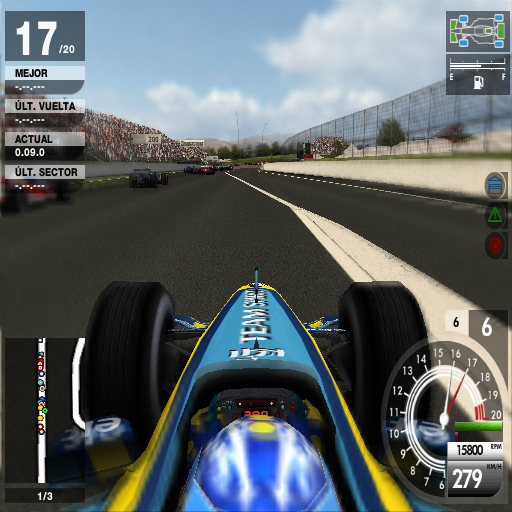
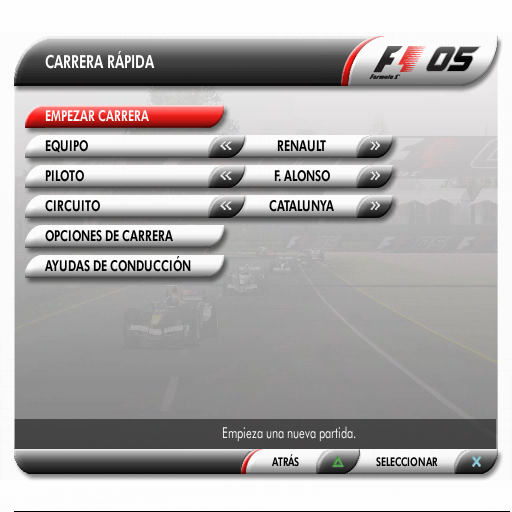

# F1 05 PC: a native Windows port of Formula One 05 (PS2) by static recompilation

> **Fan project. Not affiliated with, endorsed by or connected to Sony Interactive Entertainment, SCE Studio Liverpool,
> Formula One Group, the FIA or any other rights holder.** No game data is distributed: you need your own copy of the
> game. [Español más abajo](#español).

**F1 05 PC** turns the European PlayStation 2 release of *Formula One 05* (PAL, SCES-53033) into a native Windows
program. This is not an emulator running the disc: the game's MIPS code is translated ahead of time into C++ with
[PS2Recomp](https://github.com/ran-j/PS2Recomp) and compiled into a normal `.exe`, together with a runtime that stands
in for the PS2 hardware (EE, IOP, VU1, SPU2) and draws the GS graphics on your graphics card through
[paraLLEl-GS](https://github.com/Arntzen-Software/parallel-gs) (Vulkan).

It is the sibling of [F1 06 PC](https://github.com/KevinL50-sysadmin/F1-06-PC), on the same foundations, but with a
different goal: **the original PS2 game, as it is on the console**. There are no PC extras inside the game: no new
options in its menus, no photo mode, no online play. What the port adds is only what a PC needs: a window or full
screen, rendering on your graphics card, controllers, keyboard and wheel, and settings in a file (or on the game's page
in RecompLauncher).

  
  

Screenshots are in-game captures from the game's own data; the trademarks and logos visible in them belong to their
owners.

## What you get

- The PS2 game running natively on Windows, built by static recompilation.
- **GPU rendering** (paraLLEl-GS over Vulkan, `gs = gpu`, the default) with supersampling and double resolution, and a
  software renderer (`gs = cpu`) as a fallback when Vulkan or `pgs_puente.dll` is missing. Graphics already prepared
  for your card are kept in `cache\`, so there is less stutter the next time.
- **Display**: window, borderless or full screen, window size, aspect ratio (4:3, 16:9, console pixels), scaling
  filter (nearest, bilinear, sharp pixels, AMD FSR 1, CRT), V-Sync and an FPS counter.
- **Controls**: controller, keyboard and steering wheel, with vibration.
- **Memory cards** in `saves\mc0` and `saves\mc1`.
- **Crash reports** with the log attached (see [Reporting a problem](#reporting-a-problem)).

## Requirements

- Windows 10 or 11, 64-bit.
- A graphics card with Vulkan for the normal (GPU) mode; without it the game draws in software mode (much slower).
- **Your own copy of Formula One 05 for PS2, European PAL version (SCES-53033)**: the Redump "Europe, Australia
  (v1.02)" dump, as an `.iso` file made from your own disc. Other regions and versions are not supported.
- About 3.6 GB of free space for the game data copied from your ISO.
- CPU: the game's speed depends mostly on the speed of one processor core. When the CPU cannot keep up, the game does
  not skip frames: it runs in slow motion.

## How to get it

Download one of these from [the latest release](https://github.com/KevinL50-sysadmin/F1-05-PC/releases/latest). What
changed in each version is in [CHANGELOG.md](CHANGELOG.md).

- **Installer** (`F1-05-PC-vX.Y.Z-setup.exe`): creates "F1 05" shortcuts in the Start menu and on the desktop;
  uninstall from Settings > Apps (it asks whether to also delete your saves and options). One installer page lets you
  choose your ISO (already filled in if one is found in your Downloads or on your Desktop) and copies the game data
  during the installation; leave it blank to do it on the first run instead.
- **Portable** (`F1-05-PC-vX.Y.Z-portable.zip`): unzip the folder anywhere and open `F1-05.exe`. Everything is saved
  inside that folder, so you can move it or carry it on a USB stick.
- **[RecompLauncher](https://recomplauncher.com)**: add F1 05 and choose your ISO once. The launcher checks it
  against the known good dump, copies the game data and then starts the game with **Play**. The display and graphics
  settings also appear on the game's page in the launcher.

Windows may show "Windows protected your PC" (SmartScreen) because the `.exe` is not signed: click **More info** and
then **Run anyway**.

Dump your own disc: the project will never tell you where to download a game image, and does not ship one.

## First run

If the game data is not there yet, the game asks once for your Formula One 05 ISO. It offers an ISO found in your
Downloads folder, on your Desktop or next to the `.exe` (or lets you browse for one; the `SYSTEM.CNF` of an already
extracted disc folder also works), checks that it is the PAL version (SCES-53033), copies the game files to `data\`
with a progress bar that can be cancelled, and starts. The ISO is only read, never changed. After that you just play.

If the copy is interrupted or cancelled, nothing is left half done and the game asks again. From the command line,
`F1-05.exe --extraer-iso "path\game.iso"` copies the disc without opening the game and `F1-05.exe --comprobar-iso
"path\game.iso"` only checks it (exit codes: 0 done or already there, 1 wrong usage, 2 not Formula One 05 PAL, 3 read,
write or space error, 4 cancelled).

## Controls and settings

- Controller, keyboard or wheel. Buttons and keys are set in `config\controls.ini`, which is explained inside.
- **F11** switches between window and full screen, **F10** changes the aspect ratio (4:3, 16:9, console pixels).
- Close the window (X or Alt+F4) to quit.
- The PC settings (window mode and size, aspect ratio, scaling filter, supersampling, double resolution, V-Sync, FPS
  counter, volume, audio latency and mono, vibration strength, graphics renderer) are in `config\settings.ini`, each
  one explained inside (in Spanish). Delete the file to go back to the defaults. With RecompLauncher you can change
  them on the game's page.
- Supersampling and double resolution only load the graphics card: raise them if it has room, lower them if it is
  very busy. On a slow CPU they do not help.

## Where everything is

| What | Portable | Installed |
|---|---|---|
| Game data copied from your ISO | `data\` | `data\` next to the `.exe` (`%LOCALAPPDATA%\F1-05\data` if the game folder cannot be written) |
| Settings (`settings.ini`, `controls.ini`) | `config\` | `Documents\My Games\F1-05\config` |
| Memory cards (your saves) | `saves\mc0`, `saves\mc1` | `Documents\My Games\F1-05\saves` |
| Log | `logs\F1-05.log` | `%LOCALAPPDATA%\F1-05\logs\F1-05.log` |
| Graphics cache (can be deleted) | `cache\` | `%LOCALAPPDATA%\F1-05\cache` |

The portable version is portable because of the `portable.txt` file next to the `.exe`. Copy `saves\` to back up your
saves.

## Known limitations

- With 20 cars at the start and in the pit lane the frame rate can dip briefly below 50; the first race after
  installing also compiles the graphics for your card once (the cache avoids it next time).
- With the software renderer (`gs = cpu`) the pause menu sometimes does not appear: the picture stays on the last
  frame of the race. It does not happen with the GPU renderer, the default.
- The executable is not code-signed, so SmartScreen warns on first run.

## Reporting a problem

- **With [RecompLauncher](https://recomplauncher.com):** if the game closes because of a failure (it then exits with
  a code other than 0), the launcher offers to send the report with `F1-05.log` already attached.
- **Otherwise:** open an issue at https://github.com/KevinL50-sysadmin/F1-05-PC/issues (you need a free GitHub
  account), say what you were doing and attach `F1-05.log` (see the table above for where it is).

Each start replaces the log; the previous session stays in `F1-05.anterior.log`, so attach that one if you opened the
game again after the problem. If the game freezes, wait about 10 seconds before closing it: the log then records
where it got stuck (that wait is `vigilante` in `config\settings.ini`). The log holds the game version, your Windows,
CPU, RAM, graphics card and game settings, plus folder paths that can include your Windows user name; nothing else
from your PC.

## Legal notice

*Formula One 05* is © its respective owners. "Formula One", "Formula 1", "F1", "PlayStation", "PS2" and related marks
are trademarks of their respective owners and are used here only to describe what the project is compatible with.
This is an independent, non-commercial fan project. It is not affiliated with, endorsed by or sponsored by Sony
Interactive Entertainment, SCE Studio Liverpool, Formula One Group, the FIA or any other rights holder. No game
assets, ISO images or BIOS files are distributed. Making a personal backup of a game you own is treated differently
from country to country, so check your local law. If you are a rights holder and have a concern, please open an issue.

## Credits and third-party software

- **[PS2Recomp](https://github.com/ran-j/PS2Recomp)**: the PlayStation 2 static recompiler and runtime this port is
  built on (GPL-3.0). This project's changes to it are kept as patches in `parches/`.
- **[paraLLEl-GS](https://github.com/Arntzen-Software/parallel-gs)**: GS rendering on the GPU with Vulkan (LGPL-3.0
  or later), with **[Granite](https://github.com/Themaister/Granite)** (MIT), **volk** (MIT) and **Vulkan-Headers**
  (Apache-2.0 or MIT). Their source and licenses ship in the package's `licenses\` folder.
- **[raylib](https://github.com/raysan5/raylib)** (zlib) and **[Dear ImGui](https://github.com/ocornut/imgui)** (MIT),
  pulled in by PS2Recomp's runtime; other PS2Recomp build dependencies: fmt, ELFIO, toml11, libdwarf, rabbitizer,
  nlohmann/json (each under its own license).
- **AMD FidelityFX Super Resolution 1** (EASU and RCAS, MIT), adapted to GLSL for the FSR scaling filter.
- **FFmpeg** DLLs for the game's videos (LGPL).
- Built on the work done for [F1 06 PC](https://github.com/KevinL50-sysadmin/F1-06-PC).
- Thanks to SCE Studio Liverpool for the original game, and to the PS2 preservation and recompilation communities.

Project license: [GNU GPL-3.0](LICENSE), the same as PS2Recomp, which the runtime derives from. The license covers the
port's own code only; Formula One 05 and its data belong to their owners and are never included.

## Building from source (developers)

The repository holds only the project's own work: `src/` (game-specific overrides), `parches/` (patches over
PS2Recomp), `gpu/pgs_puente/` (the paraLLEl-GS bridge DLL), `config/recomp.toml`, `scripts/` (build, packaging and
analysis tools; comments in Spanish) and the root `.cmd` build scripts. It never contains game data, the game's
executable or the C++ code generated from it.

Outline (Windows, from the project root):

1. Clone [PS2Recomp](https://github.com/ran-j/PS2Recomp) into `third_party\PS2Recomp`, check out the base commit
   `2c5fbb9389e11dd95693385969490c9e8e6f57b4` and apply `parches\*.patch` on top of it in numeric order (for example
   `git apply --whitespace=nowarn` for each one, from `0001` up).
2. Put portable MSVC, Windows SDK, CMake and Ninja in `tools\` (`entorno.cmd` sets up a console with them).
3. `compilar-ps2recomp.cmd` builds PS2Recomp in `build\ps2recomp`.
4. Extract your own disc into `juego\` (`scripts\iso_ps2.py`), then `recompilar.cmd` translates `juego\SCES_530.33` to
   C++ and builds the executable (`compilar-runner.cmd` rebuilds it after changes in `src\`).
5. `scripts\obtener-parallel-gs.ps1` fetches paraLLEl-GS at the pinned commit and builds `pgs_puente.dll`.
6. `ejecutar.cmd` runs the development build; `scripts\empaquetar.ps1` makes the portable package and the installer.

---

## Español

> **Proyecto de fans. Sin relación con Sony Interactive Entertainment, SCE Studio Liverpool, Formula One Group, la FIA
> ni ningún otro titular de derechos, ni respaldado por ellos.** No se distribuye nada del juego: necesitas tu propia
> copia.

**F1 05 PC** convierte la edición europea de PlayStation 2 de *Formula One 05* (PAL, SCES-53033) en un programa nativo
de Windows. No es un emulador que lee el disco: el código MIPS del juego se traduce de antemano a C++ con PS2Recomp y
se compila en un `.exe` normal, con un runtime que hace de hardware de la PS2 y dibuja los gráficos en tu tarjeta
gráfica con paraLLEl-GS (Vulkan). Es el hermano de [F1 06 PC](https://github.com/KevinL50-sysadmin/F1-06-PC), pero
con otro objetivo: **el juego original de PS2, tal como es en la consola**, sin extras de PC dentro del juego (ni
opciones nuevas en sus menús, ni modo foto, ni juego en red). Solo añade lo que necesita un PC: ventana o pantalla
completa, dibujo por GPU, mando, teclado y volante, y opciones en un archivo (o en la ficha de RecompLauncher).

**Requisitos:** Windows 10/11 de 64 bits, tarjeta gráfica con Vulkan (sin ella, modo Software, mucho más lento), unos
3,6 GB libres y **tu propia copia de Formula One 05 PAL (SCES-53033)**, el volcado Redump "Europe, Australia (v1.02)",
en una `.iso` hecha de tu disco. Lo que más cuenta es la velocidad de un núcleo de la CPU: si no llega, el juego va a
cámara lenta (no se salta fotogramas).

**Cómo conseguirlo:** descarga el instalador o el `.zip` portable de
[la última versión](https://github.com/KevinL50-sysadmin/F1-05-PC/releases/latest), o añádelo en
[RecompLauncher](https://recomplauncher.com) y elige tu ISO una vez. El instalador crea los accesos "F1 05" y puede
copiar los datos de tu ISO durante la instalación. Si no, la primera vez el juego te pide la ISO una sola vez (te
ofrece la que encuentre en Descargas, en el Escritorio o junto al `.exe`, o la buscas tú), comprueba que es la PAL
(SCES-53033), copia los datos a `data\` con una barra de progreso que se puede cancelar y arranca. La ISO solo se lee.
Si Windows avisa con SmartScreen ("Windows protegió su PC"), pulsa "Más información" y "Ejecutar de todas formas".
Vuelca tu propio disco: el proyecto no dice dónde descargar imágenes de juegos ni las distribuye.

**Controles y opciones:** mando, teclado o volante, con vibración; botones y teclas en `config\controls.ini`. F11
pantalla completa o ventana, F10 aspecto (4:3, 16:9, píxeles de la consola). Para salir, cierra la ventana. Las
opciones de PC (ventana, tamaño, aspecto, filtro de escalado, supersampling, doble resolución, sincronización
vertical, contador de FPS, volumen, latencia y mono del sonido, vibración y dibujo por GPU o CPU) están en
`config\settings.ini`, explicadas dentro; bórralo para volver a las de serie. Con RecompLauncher se cambian en la ficha
del juego.

**Dónde está todo:** en la portable, todo dentro de la carpeta del juego (`data\`, `config\`, `saves\mc0` y
`saves\mc1`, `logs\`, `cache\`). Instalado: opciones y partidas en `Documentos\Mis juegos\F1-05`, y el log y la caché en
`%LOCALAPPDATA%\F1-05`.

**Limitaciones conocidas:** con 20 coches en la salida y en boxes las imágenes por segundo pueden bajar un momento
de 50; con el dibujo por CPU (`gs = cpu`) el menú de pausa a veces no se ve (con la GPU, la de
serie, no pasa); el `.exe` no está firmado.

**Cómo enviar un fallo:** si juegas con RecompLauncher y el juego se cierra por un fallo, el lanzador te ofrece enviar
el informe con `F1-05.log` ya adjunto. Si no, abre un issue en https://github.com/KevinL50-sysadmin/F1-05-PC/issues
(hace falta una cuenta gratuita de GitHub), cuenta qué estabas haciendo y adjunta `F1-05.log`: `logs\F1-05.log` en la
portable, `%LOCALAPPDATA%\F1-05\logs\F1-05.log` instalado. Cada arranque lo sustituye: la partida anterior queda en
`F1-05.anterior.log`. Si el juego se congela, espera unos 10 segundos antes de cerrarlo: así el log anota dónde se
quedó parado. El log puede llevar tu nombre de usuario de Windows en las rutas.

**Aviso legal:** proyecto de fans independiente y sin ánimo de lucro. *Formula One 05* y las marcas "Formula One",
"F1", "PlayStation" y relacionadas pertenecen a sus dueños y solo se nombran para describir la compatibilidad. No se
distribuyen recursos del juego, ISO ni BIOS.

**Créditos y licencia:** PS2Recomp (GPL-3.0), paraLLEl-GS (LGPL-3.0+), Granite, volk y Vulkan-Headers, raylib, Dear
ImGui, AMD FSR 1 y FFmpeg; detalles en la sección en inglés y licencias en `licenses\` del paquete. Licencia del
proyecto: GPL-3.0, solo para el código propio del port.
